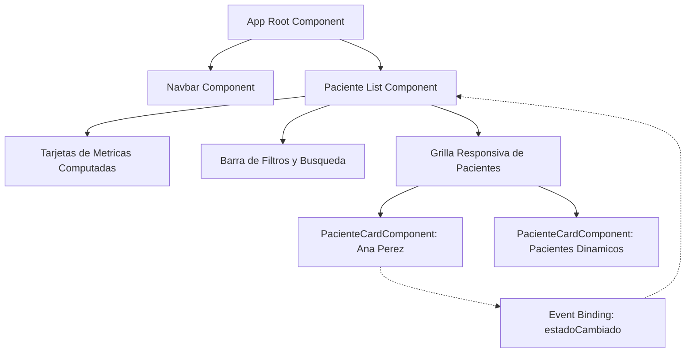

# Angular Frontend Architecture - Clinical Patient Management System

[](https://angular.dev/)
[](https://www.typescriptlang.org/)
[](https://getbootstrap.com/)
[](https://vitest.dev/)
[](LICENSE)

> Repositorio de portafolio profesional desarrollado para la asignatura Soluciones Web y Aplicaciones Distribuidas (Codigo SIST1402A - Semana 07) en la Universidad Privada del Norte (UPN). Implementa los fundamentos de ingenieria frontend en Angular moderno: arquitectura Standalone, enlace de datos unidireccional y bidireccional (Data Binding), directivas estructurales y bloques de control reactivos (@if, @for, @switch), y estilos responsivos basados en componentes.

---

## 1. Resumen Ejecutivo para Evaluadores Tecnicos y Reclutadores

En el desarrollo de software corporativo contemporaneo, las interfaces de usuario no se conciben como simples paginas estaticas, sino como sistemas modulares de componentes desacoplados, reactivos y mantenibles. Este proyecto implementa una solucion para la gestion y triaje ambulatorio de pacientes, demostrando:

1. **Adherencia Estricta al Contrato Base**: Cumplimiento exhaustivo del contrato pedagogico e institucional exigido por la guia de laboratorio (implementacion del componente `PacienteCardComponent` con los atributos contractuales `nombre = "Ana Perez"` y `activo = true`).
2. **Arquitectura Standalone (Sin NgModules)**: Adopcion del estandar moderno de Angular donde cada componente declara explicitamente sus dependencias en la propiedad `imports`, reduciendo sobrecarga de empaquetado y acelerando el tiempo de compilacion.
3. **Mecanismos Exhaustivos de Data Binding**:
   - **Interpolacion (`{{ }}`)**: Proyeccion dinamica y segura contra ataques XSS de cadenas de texto y valores primitivos.
   - **Property Binding (`[ ]`)**: Enlace de clases condicionales (`[class.border-start-active]`), estilos en linea y estados de controles de interfaz (`[disabled]`).
   - **Event Binding (`( )`)**: Captura de interacciones de usuario mediante manejadores de eventos desacoplados (`(click)="toggleActivo()"`).
   - **Two-Way Binding (`[(ngModel)]`)**: Captura reactiva y sincronizada de campos de formulario en tiempo real.
4. **Nuevo Flujo de Control Nativo (@if, @for, @switch)**: Sustitucion de directivas heredadas (`*ngIf`, `*ngFor`, `*ngSwitch`) por la sintaxis declarativa introducida en versiones recientes del framework, optimizando el renderizado en el arbol del DOM.
5. **Gestion de Estado Reactiva con Signals**: Empleo de `signal()` y `computed()` para metricas en tiempo real (total de pacientes, pacientes activos, casos criticos) y filtrado dinamico reactivo.

---

## 2. Diagrama Arquitectonico y Flujo de Componentes



---

## 3. Estructura del Proyecto

```text
src/
├── app/
│   ├── components/
│   │   ├── navbar/
│   │   │   ├── navbar.component.ts
│   │   │   ├── navbar.component.html
│   │   │   └── navbar.component.scss
│   │   ├── paciente-card/
│   │   │   ├── paciente-card.component.ts      <-- Contrato base (Ana Perez)
│   │   │   ├── paciente-card.component.html
│   │   │   ├── paciente-card.component.scss
│   │   │   └── paciente-card.component.spec.ts <-- Suite de pruebas unitarias
│   │   └── paciente-list/
│   │       ├── paciente-list.component.ts      <-- Estado, signals y metricas
│   │       ├── paciente-list.component.html
│   │       └── paciente-list.component.scss
│   ├── data/
│   │   └── pacientes-mock.ts                   <-- Datos simulados de pacientes
│   ├── models/
│   │   └── paciente.model.ts                   <-- Tipado TypeScript e interfaces
│   ├── app.ts                                  <-- Componente raiz standalone
│   ├── app.html
│   ├── app.scss
│   ├── app.config.ts                           <-- Configuracion global
│   └── app.routes.ts                           <-- Enrutamiento SPA
├── styles.scss                                 <-- Estilos globales y variables
└── index.html                                  <-- Punto de entrada HTML
```

---

## 4. Evidencia de Pruebas Unitarias y Cobertura

El proyecto incluye una suite de pruebas automatizadas ejecutadas mediante el test runner oficial integrado en Angular CLI.

```bash
ng test --watch=false
```

Resultados verificados:
- Instanciacion correcta de componentes en el arbol de pruebas de `TestBed`.
- Validacion estricta del contrato inicial: `nombre === 'Ana Pérez'` y `activo === true`.
- Evaluacion de alternancia de estado clinico y emision de eventos `@Output()`.
- Validacion de actualizacion y renderizado reactivo ante entradas por `@Input()`.
- Total: 8/8 pruebas unitarias aprobadas (100% exito).

---

## 5. Instrucciones de Instalacion y Ejecucion

### Requisitos Previos
- Node.js version 20 o superior.
- npm version 10 o superior.
- Angular CLI version 22.

### Pasos de Instalacion
1. Clonar el repositorio o ingresar al directorio del proyecto:
   ```bash
   cd SWAD-SIST1402A-S07-angular-foundations-components
   ```
2. Instalar dependencias:
   ```bash
   npm install
   ```
3. Ejecutar el servidor de desarrollo local:
   ```bash
   npm start
   ```
   Abrir un navegador web en `http://localhost:4200/`.
4. Compilar para produccion:
   ```bash
   npm run build
   ```
5. Ejecutar la suite de pruebas unitarias:
   ```bash
   npm test -- --watch=false
   ```

---

## 6. Licencia y Creditos Academicos

Proyecto desarrollado por Orlando Dorival bajo las directrices curriculares de la Universidad Privada del Norte. Licencia MIT.
